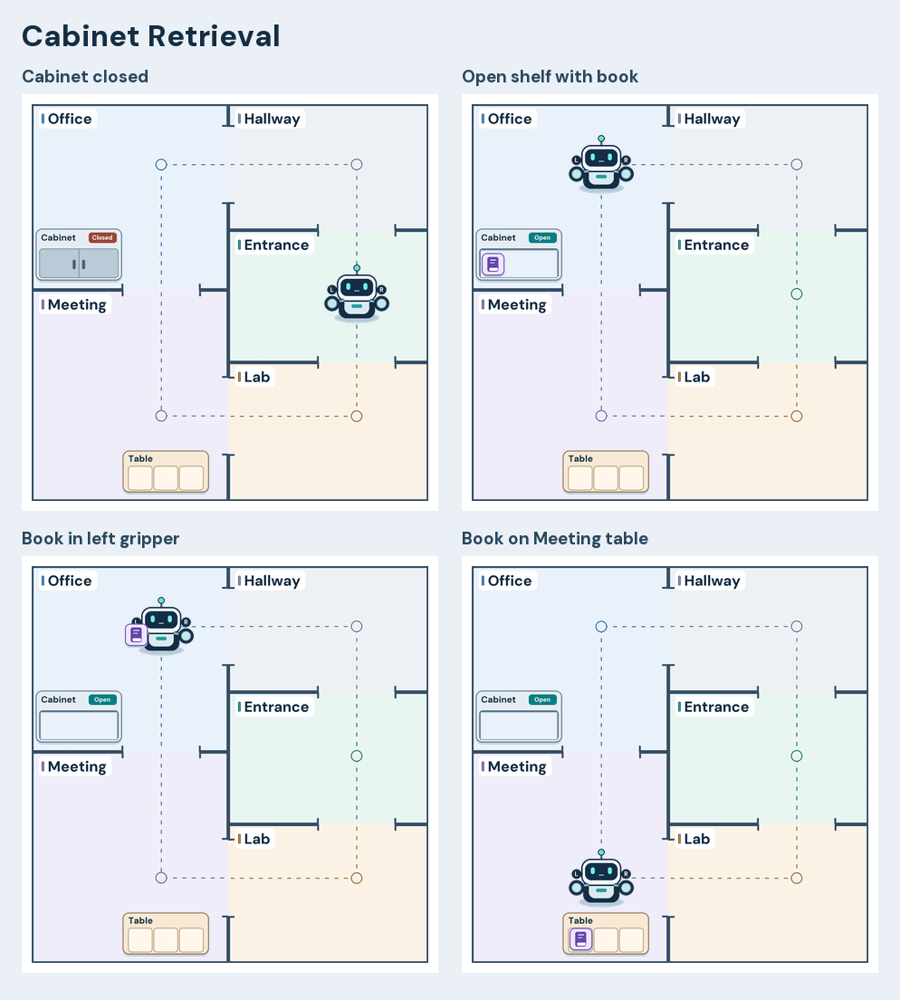
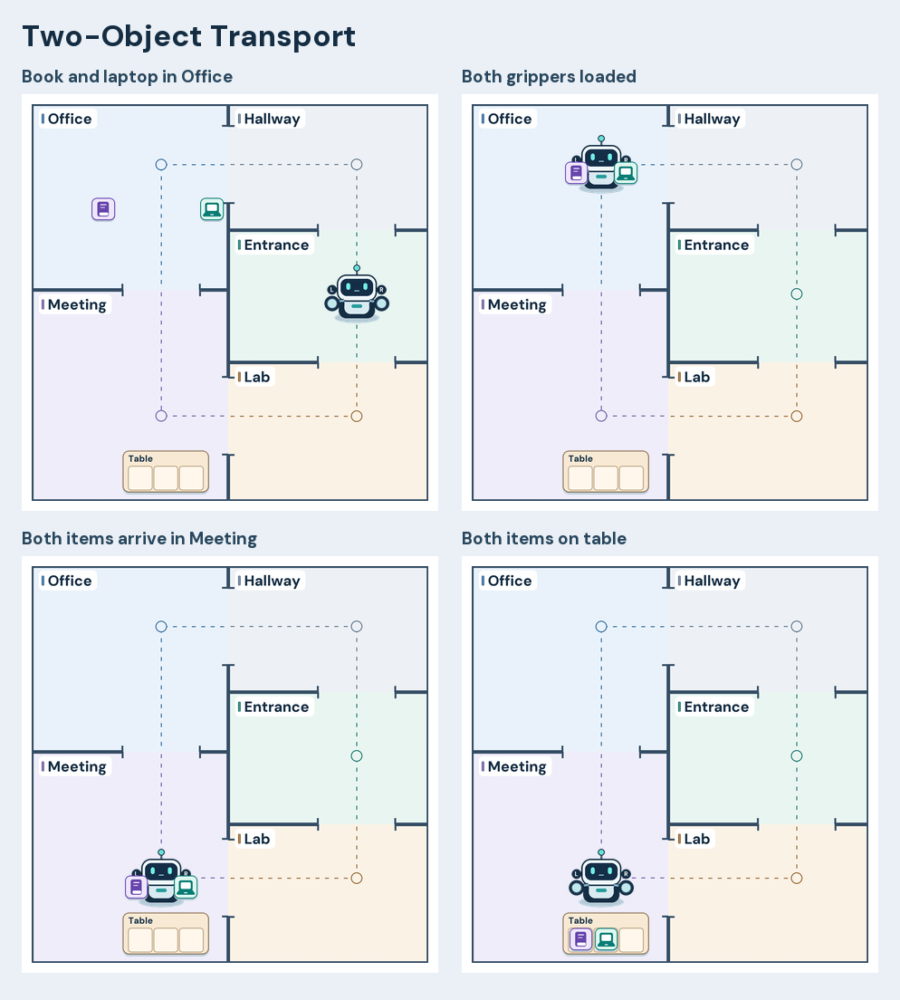

# Building animation in Planimation

## Play a scenario

1. Open [Planimation’s Problem page](https://planimation.planning.domains/problem).
2. Select **LAMA-first** in the planner menu.
3. Choose [domain.pddl](../domain.pddl) for **Domain File** and one
   [problem](../problems/) for **Problem File**.
4. Choose [symbolic_planning_AP.pddl](symbolic_planning_AP.pddl) for **Animation
   File** and click **Upload Files**.
5. Use **Play** to watch the transitions, or select individual steps. Cabinet
   Retrieval and Two-Object Transport show the full range of manipulation.
   The Gripper Capacity Test has no solution to play.

The profile embeds its PNGs. The three PDDL files are sufficient for playback.
[Planimation user guide](https://planimation.github.io/documentation/ug1/)

### Replay a Fast Downward plan

This uses the hosted Planimation visualisation file generator (VFG) with a
locally solved plan. Run from the symbolic-planning repository root with Fast
Downward built in the parent directory. Substitute the problem filename to
replay another scenario.

```sh
demo_dir=$(mktemp -d)
problem=pddl/problems/two-object-transport.pddl
python3 ../fast-downward.py --sas-file "$demo_dir/output.sas" \
  --plan-file "$demo_dir/sas_plan" pddl/domain.pddl "$problem" \
  --search 'astar(lmcut())'
sed -n '/^(/p' "$demo_dir/sas_plan" > "$demo_dir/actions.plan"
curl --fail-with-body \
  -F 'domain=<pddl/domain.pddl' \
  -F "problem=<$problem" \
  -F 'animation=<pddl/animations/symbolic_planning_AP.pddl' \
  -F "plan=<$demo_dir/actions.plan" \
  -o "$demo_dir/two-object-transport.vfg" \
  https://planimation.planning.domains/upload/pddl
```

Open [Planimation’s VFG page](https://planimation.planning.domains/vfg), select
`two-object-transport.vfg` from the temporary directory, and click
**Continue**. The action-only plan format omits the Fast Downward cost comment
that the hosted supplied-plan parser otherwise treats as plan input.
[Planimation upload handler](https://github.com/planimation/backend/blob/94d82afb5ee122ce579dd11ca1953b7c85ca5824/server/app/views.py)

## Floor plan and state mapping

- **Building.** Five labeled rooms share walls. Open thresholds and dashed
  paths show the standard layout. The rooms occupy 91% of the normalized
  square in Navigation, compared with 18% in the original profile. Labels are
  part of the room sprites and sit clear of travel paths.
- **Robot.** `robot-at` places the robot at the room’s stop. The same robot
  sprite stays visible across the plan, with L and R marked above the grippers.
- **Items.** `item-at` positions loose items inside the room. `holding` uses the
  selected gripper’s offset. `on-table` and `delivered-to` place items in stable
  slots on the table or the person’s delivery tray.
- **Cabinet.** `in-cabinet` positions items on its shelf. The closed cabinet
  front covers them, and `cabinet-open` swaps in a front with a clear shelf.
  The book itself keeps the same sprite through retrieval, transport, and
  placement.
- **Door.** `door-between` anchors the door between the two room stops.
  `door-closed` selects the closed leaf. When the predicate is removed, the
  player shows the open leaf and threshold.

Planimation derives one square from the sprite bounds across all stages and
normalizes each sprite against it. The redesign packs the standard building
into an 840 × 840 schematic footprint. The browser scales that square with
the height of its canvas, so the player's side panels and surplus horizontal
space are controlled by Planimation.
[Backend normalization](https://github.com/planimation/backend/blob/94d82afb5ee122ce579dd11ca1953b7c85ca5824/server/app/vfg/adapter/visualiser_adapter/Transfer.py),
[frontend rendering](https://github.com/planimation/Frontend-JS/blob/b6ad236684e6338eeab86933077df1c5f811e8f3/src/pages/PageFour/screenComponents.jsx)

## Edit and rebuild

From the repository root, with Python 3.10 or later and Pillow installed:

```sh
python3 -m pip install Pillow==12.0.0
python3 pddl/animations/source/build_profile.py
python3 pddl/animations/source/build_profile.py --check
```

- [build_profile.py](source/build_profile.py) contains the room footprints,
  stops, furniture anchors, item offsets, and sprite drawings. The bundled
  DM Sans font is distributed under the [SIL Open Font License](source/OFL-DM-Sans.txt).
- [rules.pddl.in](source/rules.pddl.in) contains the AP predicate rules.
  Furniture anchors resolve before item placement. The cabinet front stays
  above the item layer, so its state can hide the book without changing the
  item's identity or drawing order.
- AP coordinates start at the lower-left corner. Sprite drawings start at
  the upper-left. Room stops and furniture anchors are illustrative visual
  coordinates. The original domain and problem files are unchanged.
- Existing rooms can be reused directly. For a new room, add a named
  `Room` entry and its thresholds in `CONNECTIONS`. Planimation selects
  predefined visuals by object name or name prefix. An unrecognized item uses
  a generic sprite and the first slot. To place it beside another item, add
  its tray slot and loose position to the generator. Tables, cabinets, and
  people get their visual type from their location predicates. Additional
  fixtures of the same kind in one room need separate anchors.
- The two built-in grippers have separate numeric anchors. If the domain
  gains another gripper, give it a defined docking position and update the
  robot artwork. The current door artwork fits a horizontal threshold at
  the midpoint of the Office and Meeting stops. Other wall orientations or
  off-center thresholds can need adjusted anchors and artwork.
  [Planimation AP guide](https://planimation.github.io/documentation/ap_guide/),
  [official examples](https://github.com/planimation/documentation/tree/master/AnimationProfiles)

## Playback limits

The web player interpolates positions linearly between consecutive stages.
Robot and carried items keep their relative positions through that transition.
Door and cabinet images switch at the stage boundary. The profile uses the
player’s built-in interpolation, so action choreography, curved routes, and
wheel or gripper motion are outside its scope. Thresholds are part of the
schematic and may still be visible at the outer edge when a problem declares
only part of the building. Actual access comes from the planning predicates.
[Planimation player](https://github.com/planimation/Frontend-JS/blob/b6ad236684e6338eeab86933077df1c5f811e8f3/src/pages/PageFour/index.js)

## Validation

Fast Downward 26.6 with `astar(lmcut())` solved the six scenarios below. The
hosted Planimation VFG accepted the profile and returned all 33 states.
An independent STRIPS replay checked action preconditions, effects, and final
goals against the sprite positions and state images. The Planimation browser
player was stepped through the returned stages. A slowed Office-to-Meeting
transition in Two-Object Transport confirmed that both items move with the
robot through the threshold.

| Scenario | Actions / states | Verified sequence |
| --- | ---: | --- |
| Navigation | 2 / 3 | Entrance → Lab → Meeting |
| Object Delivery | 5 / 6 | Book loose in Office → robot via Hallway to Office → book in left gripper → Meeting → book on table |
| Two-Object Transport | 7 / 8 | Book and laptop loose in Office → robot via Hallway to Office → book in left gripper → laptop in right gripper → Meeting with both → book on table → laptop in adjacent slot |
| Human Handover | 5 / 6 | Book loose in Office, professor in Meeting → robot via Hallway to Office → book in left gripper → Meeting → book in professor’s tray and gripper clear |
| Door Navigation | 2 / 3 | Robot in Office with door closed → door open, robot still in Office → robot in Meeting |
| Cabinet Retrieval | 6 / 7 | Cabinet closed with book hidden → robot via Hallway to Office → open shelf reveals book → book in left gripper and shelf empty → Meeting → book on table |
| Gripper Capacity Test | Unsolvable | Fast Downward proved the original task unsolvable. A temporary check with the otherwise unplaced cup added to Office also failed because the goal requires two items in the same gripper. |

The original navigation profile was loaded for visual comparison. The original
Cabinet Retrieval and Two-Object Transport failed in the hosted generator
because their negative left-gripper property was parsed as text. The revised
profile uses numeric offsets for both grippers.

The frames below were rendered from the hosted VFG output. Browser playback
used those same VFG files.




